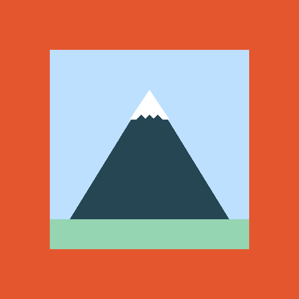
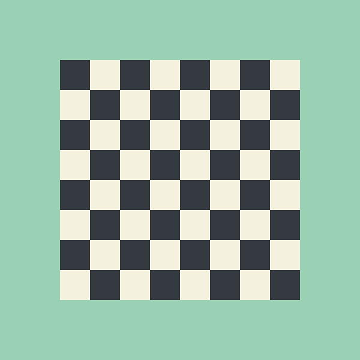
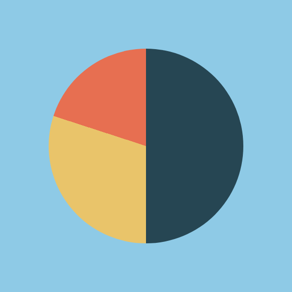
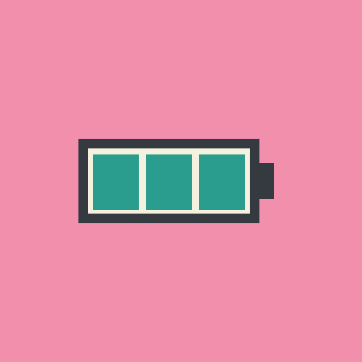

# One Div

What can a single `<div>` become? Drawings built entirely with CSS: no images, no SVGs, one element each.

**Live:** [onediv.akashsrma.com](https://onediv.akashsrma.com) · By [Akash Sharma](https://akashsrma.com) · An ode to [A Single Div](https://a.singlediv.com/) by Lynn Fisher.

Every drawing is the same markup, and only the CSS changes:

```html
<div class="single-div"></div>
```

## The drawings

Click a thumbnail to open it on the site, or the file to read its CSS.

<!-- pieces:start -->
| | # | Drawing | Level | CSS |
|---|---|---|---|---|
| <a href="https://onediv.akashsrma.com/#01-tricolour"></a> | 01 | [Tricolour](https://onediv.akashsrma.com/#01-tricolour) | 1 | [pieces/01-tricolour.html](pieces/01-tricolour.html) |
| <a href="https://onediv.akashsrma.com/#02-sunset-bands"></a> | 02 | [Sunset bands](https://onediv.akashsrma.com/#02-sunset-bands) | 1 | [pieces/02-sunset-bands.html](pieces/02-sunset-bands.html) |
| <a href="https://onediv.akashsrma.com/#03-diagonal-split"></a> | 03 | [Diagonal split](https://onediv.akashsrma.com/#03-diagonal-split) | 1 | [pieces/03-diagonal-split.html](pieces/03-diagonal-split.html) |
| <a href="https://onediv.akashsrma.com/#04-circle"></a> | 04 | [Circle](https://onediv.akashsrma.com/#04-circle) | 1 | [pieces/04-circle.html](pieces/04-circle.html) |
| <a href="https://onediv.akashsrma.com/#05-target"></a> | 05 | [Target](https://onediv.akashsrma.com/#05-target) | 1 | [pieces/05-target.html](pieces/05-target.html) |
| <a href="https://onediv.akashsrma.com/#06-mountain"></a> | 06 | [Mountain](https://onediv.akashsrma.com/#06-mountain) | 1 | [pieces/06-mountain.html](pieces/06-mountain.html) |
| <a href="https://onediv.akashsrma.com/#07-candy-stripes"></a> | 07 | [Candy stripes](https://onediv.akashsrma.com/#07-candy-stripes) | 1 | [pieces/07-candy-stripes.html](pieces/07-candy-stripes.html) |
| <a href="https://onediv.akashsrma.com/#08-checkerboard"></a> | 08 | [Checkerboard](https://onediv.akashsrma.com/#08-checkerboard) | 1 | [pieces/08-checkerboard.html](pieces/08-checkerboard.html) |
| <a href="https://onediv.akashsrma.com/#09-polka-dots"></a> | 09 | [Polka dots](https://onediv.akashsrma.com/#09-polka-dots) | 1 | [pieces/09-polka-dots.html](pieces/09-polka-dots.html) |
| <a href="https://onediv.akashsrma.com/#10-pie-chart"></a> | 10 | [Pie chart](https://onediv.akashsrma.com/#10-pie-chart) | 1 | [pieces/10-pie-chart.html](pieces/10-pie-chart.html) |
| <a href="https://onediv.akashsrma.com/#11-three-layers"></a> | 11 | [Three layers](https://onediv.akashsrma.com/#11-three-layers) | 2 | [pieces/11-three-layers.html](pieces/11-three-layers.html) |
| <a href="https://onediv.akashsrma.com/#12-traffic-light"></a> | 12 | [Traffic light](https://onediv.akashsrma.com/#12-traffic-light) | 2 | [pieces/12-traffic-light.html](pieces/12-traffic-light.html) |
| <a href="https://onediv.akashsrma.com/#13-dice"></a> | 13 | [Dice](https://onediv.akashsrma.com/#13-dice) | 2 | [pieces/13-dice.html](pieces/13-dice.html) |
| <a href="https://onediv.akashsrma.com/#14-battery"></a> | 14 | [Battery](https://onediv.akashsrma.com/#14-battery) | 2 | [pieces/14-battery.html](pieces/14-battery.html) |
| <a href="https://onediv.akashsrma.com/#15-bar-chart"></a> | 15 | [Bar chart](https://onediv.akashsrma.com/#15-bar-chart) | 2 | [pieces/15-bar-chart.html](pieces/15-bar-chart.html) |
<!-- pieces:end -->

## How it's built

A static page with no build step and no dependencies.

```
index.html          the gallery
assets/site.css
assets/site.js      reads pieces.json and draws each piece in its own shadow root
pieces.json         one entry per drawing
pieces/NN-slug.html one file per drawing: the markup and its CSS, exactly as written
thumbs/             README thumbnails (generated)
tools/              render.html + readme.py, which make the thumbnails and the table above
wrangler.jsonc      Cloudflare config: serve this folder as static files
.assetsignore       repo files that aren't uploaded to the site
```

Each piece renders inside its own shadow root, so one drawing's `.single-div` rule can't leak into another. Each tile's background colour and width come from `pieces.json` (`bg`, `wide`), not from the drawing's CSS.

### A piece

```html
<!--
  06 · Mountain · level 1
  Submitted: 2026-10-21
-->
<div class="single-div-stage">
  <div class="single-div"></div>
</div>

<style>
.single-div { /* … */ }
</style>
```

`.single-div` is the drawing. `.single-div-stage` is the frame the gallery sizes and centres; it isn't part of the drawing.

### pieces.json

```json
{
  "n": 6,
  "slug": "mountain",
  "title": "Mountain",
  "level": 1,
  "bg": "#f4a261",
  "wide": false,
  "tags": [],
  "file": "pieces/06-mountain.html",
  "codepen": null,
  "submitted": "2026-10-21",
  "revised": null,
  "animated": false
}
```

### Adding a drawing

1. Add `pieces/NN-slug.html` and its entry in `pieces.json`.
2. Run `python3 tools/readme.py` (needs Python 3 and Google Chrome) to make the thumbnail and refresh the table.
3. Commit and push. The site deploys from `production`.

## Run it locally

It fetches `pieces.json` and the piece files, so serve it over HTTP rather than opening the file:

```sh
python3 -m http.server 8765
# http://localhost:8765, and http://localhost:8765/#06-mountain opens one drawing
```
